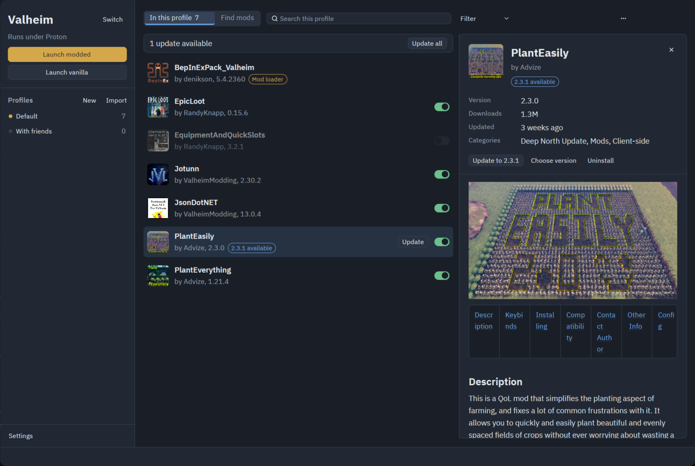
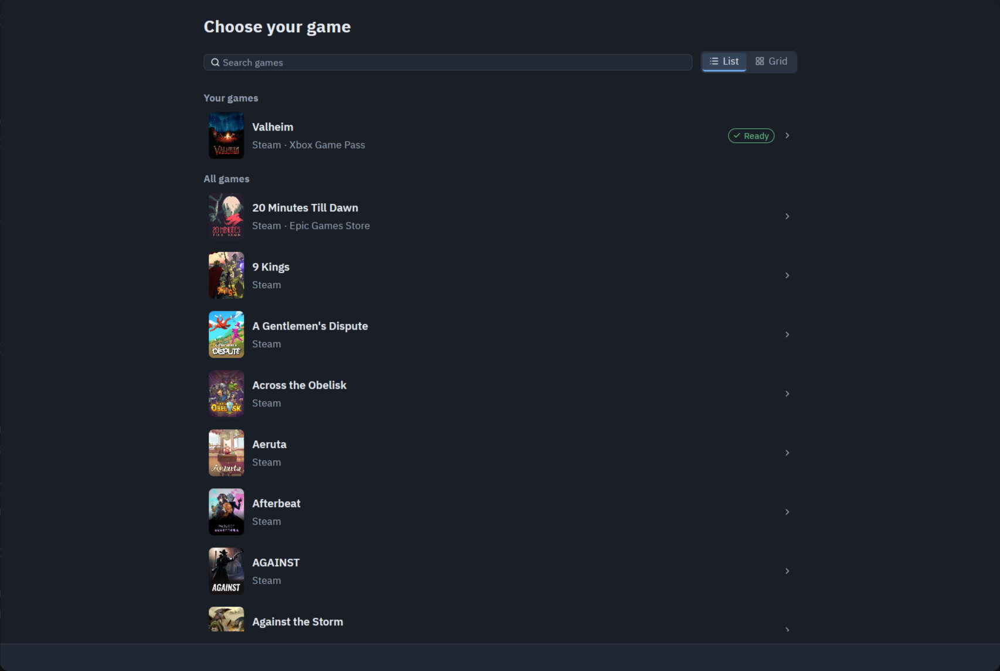
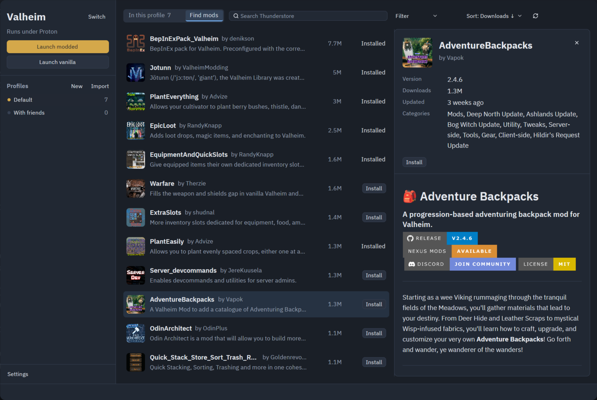
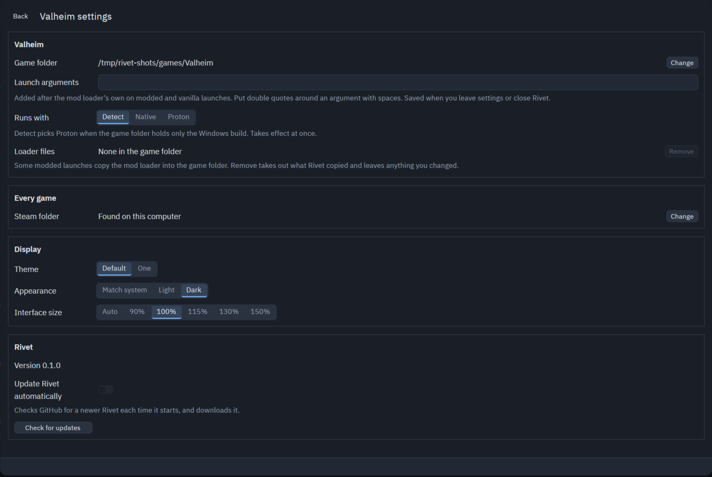

# Rivet

Rivet is a free mod manager for games with mods on [Thunderstore](https://thunderstore.io), such as Valheim, Lethal Company and Risk of Rain 2. It finds mods, installs them with everything they need, keeps them up to date, and starts your game with them loaded.

If you've used r2modman, Rivet works the same way and can bring your r2modman profiles across.

Download Rivet from the [Releases page](https://github.com/endoze/rivet/releases): `rivet-windows-x86_64.exe` for Windows or `rivet-linux-x86_64` for Linux. Each comes with a `.sha256` file to check the download against.

## Your first mods

1. **Choose your game.** Search the list and pick it. If it's a Steam game, Rivet finds where it's installed. If not, Rivet asks you to choose the game's folder.

   

2. **Find mods.** Open the **Find mods** tab to browse everything on Thunderstore for that game. Search by name, sort the list, or filter by category. Click a mod to read about it in the details panel.

   

3. **Install.** Press **Install** on a mod. Rivet shows you any other mods that come with it, then installs them all.
4. **Play.** Press **Launch modded** in the left sidebar. **Launch vanilla** starts the game with no mods and leaves your mods untouched.

## Profiles

A profile is one set of mods for a game. Every game starts with a profile called Default. Make more to keep separate setups, such as one for playing with friends and one for trying new mods.

Your profiles are listed in the sidebar; click one to see its mods. Use **New** to make an empty profile, and right-click a profile to rename, duplicate, delete or share it.

## Managing your mods

The **In this profile** tab lists the mods in the open profile.

- **Turn a mod off** with its switch. It stays installed, so you can turn it back on later. Handy for finding which mod is causing a problem.
- **Update** a mod from its row when a newer version is out, or update every mod at once with **Update all** above the list.
- **Uninstall** a mod by clicking it and pressing **Uninstall** in the details panel.
- **Stay on an older version** by pressing **Choose version** in the details panel. Rivet pins that version and leaves it alone when you update everything. Press **Unpin** to follow new versions again.

When other mods need the one you're turning off or uninstalling, Rivet asks whether to change only that mod or those other mods too.

Your mods' settings files are kept when a mod updates.

## Sharing a profile

Right-click a profile and choose **Share as code** to get a short code a friend can paste into Rivet or r2modman, or **Share as file** to save a `.r2z` file. To bring in someone else's profile, press **Import** in the sidebar and paste their code or choose their file. It's added as a new profile with the same mods at the same versions.

If you have r2modman profiles for a game, Rivet offers to copy them in when you open that game. It copies them and never changes r2modman's own files. You can also do it later from **Import**.

## Linux and Steam

Rivet works out whether a game runs natively on Linux or through Proton, and shows which in the sidebar. You can change this in **Settings** if it guesses wrong.

For some native Linux games, Steam needs one extra line in the game's launch options before mods load. Rivet shows the line with a **Copy** button: in Steam, right-click the game, choose **Properties**, and paste it into **Launch Options**. Restart Steam afterwards, because Steam only saves launch options when it closes. Rivet tells you once the line is in place.

## Settings

Press **Settings** in the sidebar to:

- change the game's folder or your Steam folder
- add launch arguments for the game
- choose whether the game runs natively or through Proton (Linux)
- pick a light or dark look, a theme, and the interface size
- remove the mod loader files Rivet copied into the game's folder, to put the game back the way it was
- turn on **Update Rivet automatically**, or press **Check for updates**, to download the newest Rivet. Press **Restart to update** when it's ready.

## Where Rivet keeps its files

| | Linux | Windows |
|---|---|---|
| Settings | `~/.config/rivet` | `%APPDATA%\rivet` |
| Profiles and installed mods | `~/.local/share/rivet` | `%LOCALAPPDATA%\rivet\data` |
| Downloads and the mod list | `~/.cache/rivet` | `%LOCALAPPDATA%\rivet\cache` |

Deleting the downloads folder is safe; Rivet downloads what it needs again. Deleting the profiles folder deletes your profiles.

## Problems and ideas

Report a bug or suggest a feature on the [Issues page](https://github.com/endoze/rivet/issues). Say which game, which profile, and what you pressed before it went wrong.

## License

Rivet is free to use, share and change under the [MIT License](LICENSE).
